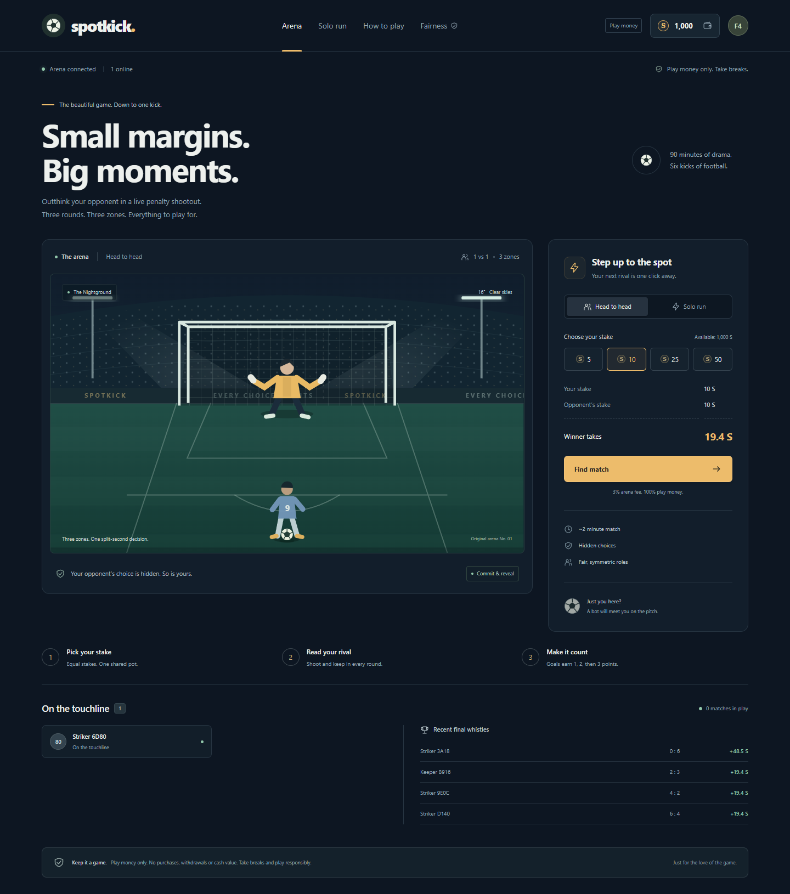
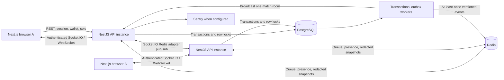
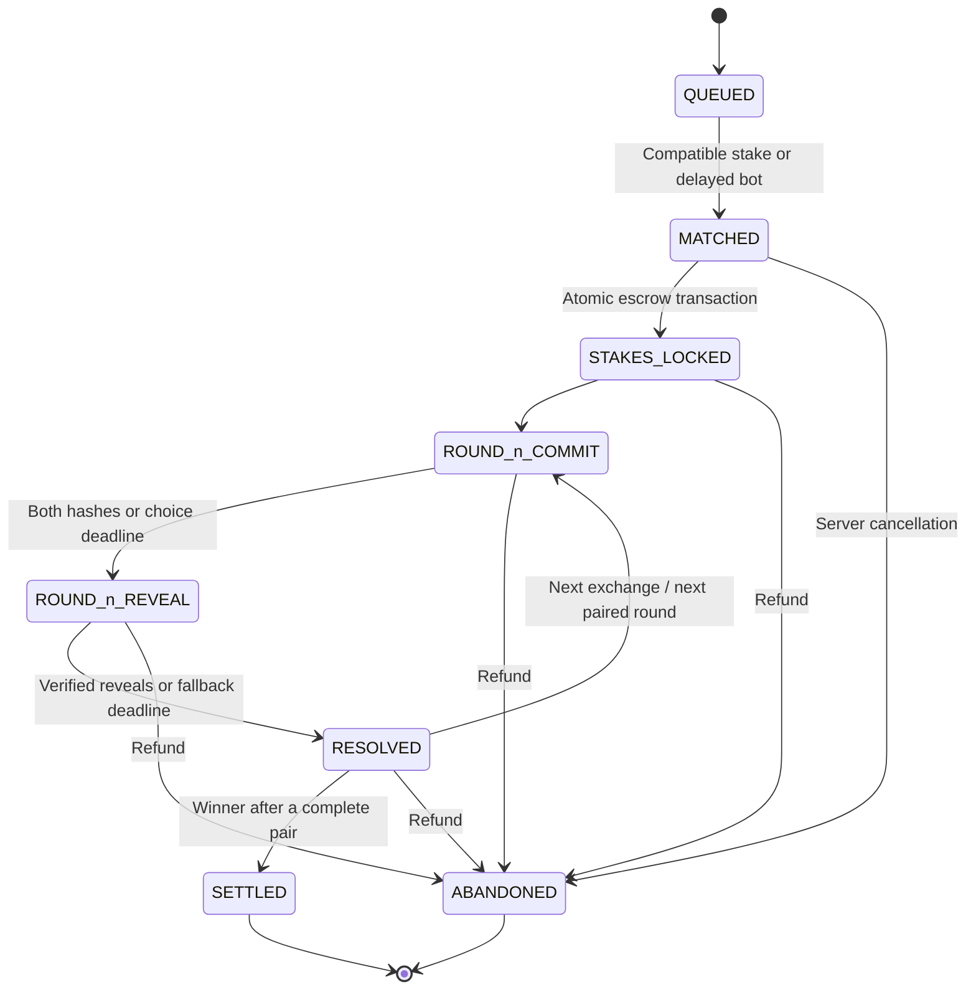
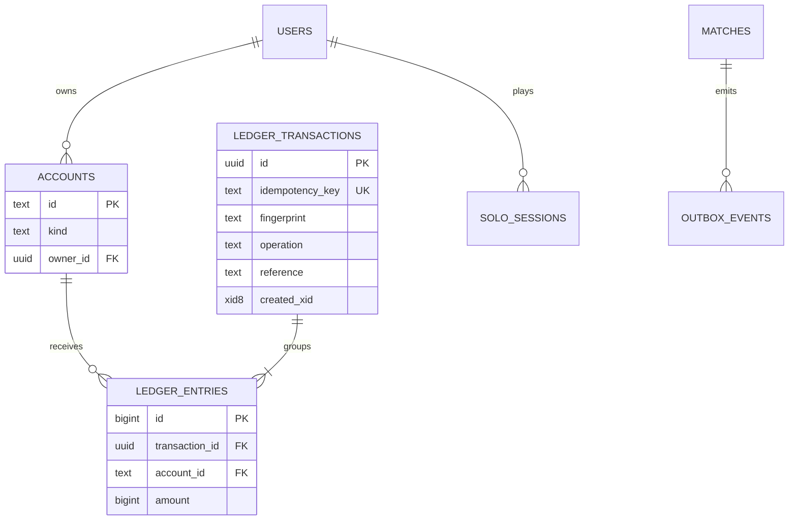

# SpotKick

A real-time penalty arena built to make concurrency, fairness and wallet consistency inspectable. NestJS 11, Next.js 15 / React 19, PostgreSQL, Redis and Socket.IO in a pnpm monorepo.

**Play money only. No purchases, withdrawals, prizes or cash value. Take breaks and play responsibly.** All stadium artwork, kits, player silhouettes and identity are original. There are no real teams, players or logos.



## Reviewing this project

Start with the [five-minute demo](docs/DEMO.md), the [engineering case study](docs/CASE_STUDY.md), or the [executed verification evidence](docs/VERIFICATION.md). The game runs without registration and supplies a bot when no human opponent is available.

For a detailed Windows checklist with commands, manual test cases and publication gates, see the [Spanish validation and publication guide](docs/GUIA_PUBLICACION.md). Its optional `compose.acceptance.yaml` uses separate local ports and supports a second API for load tests.

The project is intended as an inspectable portfolio demo. Its strongest evidence is the combination of playable flows, real database contention tests and completed matches across two API instances. A public demo URL, remote CI run and container validation are still pending; those are not implied by the screenshots or local test results.

## Run it

Install Docker with Compose v2, then run from this directory:

```sh
docker compose up --build
```

Open **http://localhost:3000**. API health: **http://localhost:3001/health**. The migration job finishes before the API becomes available. PostgreSQL and Redis volumes survive restarts. The API also checks migrations under a PostgreSQL advisory lock on startup.

Each browser profile receives a guest session and **1,000 S** in play credits. Select a stake and choose **Find match** to enter the queue, where a bot joins after five seconds if no compatible human is waiting. **Practice vs bot** starts the same head-to-head rules immediately with a bot and play credits. A separate profile or incognito window creates a second player. Refresh during a match to reconnect.

The bearer token is stored in localStorage. Clearing it creates a new guest wallet rather than recovering the old one. This is a portfolio guest-identity system, not account recovery.

For another host, set `WEB_ORIGIN` and `NEXT_PUBLIC_API_URL` before building. The browser-facing API URL is compiled into Next.js. Public hosting requires TLS/WSS and an appropriate reverse proxy.

### Local development

Requires Node 22+, pnpm 11.25.0, PostgreSQL 17+ and Redis 7+.

```sh
pnpm install --frozen-lockfile
# Copy .env.example; export its values in your shell (there is no dotenv dependency).
pnpm db:migrate
pnpm dev:api
# In another terminal:
pnpm dev:web
```

Alternatively expose the infrastructure ports with your own Compose override and run the apps locally. The default Compose file keeps database/cache ports internal.

`pnpm build` builds the shared package, API and web app. Linux/Docker builds produce a standalone Next.js bundle; Windows builds use normal Next.js output to avoid requiring Windows symbolic-link privileges. No cloud services or Sentry credentials are needed for the demo.

## Rules and balance

### Head to head

- Both players stake the same amount. A single atomic journal transaction moves both stakes into a match escrow account.
- Three rounds, with **two exchanges per round**. A shoots/B keeps, then B shoots/A keeps.
- Both participants choose left, centre or right. Matching zones save; different zones score.
- Goals award **1, 2 and 3 points** in rounds 1, 2 and 3 respectively.
- The winner is determined only after a complete pair of exchanges. A tied score enters paired sudden death, worth one point per goal, until one player scores and the other misses.
- Each choice has a 10-second window. Reveal delivery has a separate three-second grace period.
- The winner receives the pot less the configured rake: **300 basis points (3%)** by default. Rake rounds down in integer minor units. One S equals 100 minor units.

Uniform random choices give every shot a 2/3 chance to score. Both players get identical roles and scoring opportunities, including in sudden death. Escalation changes the comeback dynamics without giving either player more opportunities. There is no early termination that would deny a player their final shot. Each player has an equal chance under symmetric strategies; rake reduces the expected financial return.

### Solo run

The player chooses a stake and client seed after seeing a server-seed commitment. Score to continue or cash out. A save loses the stake. After `k >= 1` goals:

```text
multiplier(k) = 0.99 × 1.5^k
payout = floor(stake × 99 × 3^k / (100 × 2^k))
```

The implementation uses BigInt rational arithmetic, not floating-point money. Cash-out before the first goal is disallowed. At any fixed depth, before rounding, expected return is `(2/3)^k × 0.99 × 1.5^k = 0.99` of the stake. Rounding can reduce that slightly.

The house reserves the entire next-shot payout in a solo escrow account **before accepting that shot**. Continuations top up the reserve from the house bankroll. If the bankroll or safe-integer payout capacity cannot support another shot, the request is rejected before consuming a nonce and the player can cash out. The arithmetic helper allows up to 64 goals; practical capacity is reached first. There is no unbounded, unfunded house liability.

## Architecture



**PostgreSQL is authoritative.** Match snapshots, choice commitments, reveals, deadlines, guest activity and ledger entries are durable. Redis is disposable: the queue can be reconstructed from durable intents; reconnect reads PostgreSQL; cached match views never contain unrevealed choices, salts or seeds.

API processes keep socket connections and a periodic worker, but correctness does not depend on process-local game state or timers. Multiple workers coordinate with row locks and `SKIP LOCKED`. Redis-adapter broadcasts reach sockets connected to other API instances. The transport is WebSocket-only, so this demo does not require polling-session affinity.

## Authoritative state machine



`QUEUED` is a durable user intent indexed in Redis. The match row is created at `MATCHED`; stake locking and the first commit phase occur in the same database transaction. Transition history records these intermediate phases. Every exchange stores the round, shooter, deadline and monotonically increasing snapshot version.

Commands authenticate the participant, lock the match row, reject stale exchanges or late commands, and verify the phase. Invalid reveals do not mutate state. Duplicate identical commits/reveals are safe to retry. Match settlement and its outbox event commit together. Terminal matches cannot resolve or settle again.

A disconnect does not forfeit the pot: deadlines continue, using the published timeout policy. Reconnect joins the same room and reads a current snapshot. The browser saves an unrevealed choice/salt in sessionStorage before committing. If that secret is lost, the reveal deadline uses the committed fallback policy. The internal `abandon()` operation atomically refunds both stakes; there is deliberately no player-accessible refund endpoint that could cancel a losing match.

## PvP commit–reveal

For every exchange, each player locally creates a 32-byte cryptographic salt and hashes a canonical context-bound payload:

```text
SHA256(JSON.stringify([matchId, round, exchange, playerId, choice, salt]))
```

This is the commitment to `choice + salt`, domain-separated by match/player/exchange. Once both commitments are fixed, the server accepts reveals. It recomputes and compares each hash before resolving. Public snapshots expose hashes and readiness, not reveal contents. At the end the transcript contains all commitments, reveals, exceptions and the retired timeout seed; **Inspect match fairness** verifies it in the browser.

Timeout choices are deterministic HMAC choices from a **per-match seed whose SHA-256 hash is published before play**, scoped by match, player and exchange. Missing commits get a fallback commitment; missing/invalid reveals get the predefined fallback and an explicit timeout exception. An exception is not misrepresented as verification of the original hash. Bots commit deterministic choices before accepting human reveals and their commitments are verified too.

This prevents changing a committed choice after learning the opponent’s choice. It does **not** prove that a malicious operator delivered messages fairly, prevented censorship, selected seeds honestly or ran the published code. Withholding is also a liveness/fairness tradeoff: fallback is independently committed and unrevealed opponent choices remain hidden, but it is not an external consensus protocol. Production adversarial play would need signed client receipts, independent transcript publication and a more restrictive non-reveal policy.

## Solo provably-fair verification

1. The server creates a fresh random 256-bit seed and stores its SHA-256 commitment. The browser displays it before any stake is accepted.
2. The player supplies a client seed. The session retires the server seed for use by other sessions.
3. For nonce `0, 1, ...`, compute `HMAC-SHA256(serverSeed, clientSeed + ':' + nonce)`. Seeds and messages are UTF-8 strings; the server seed is the displayed hex string, not hex-decoded bytes.
4. Interpret the digest as an unsigned big-endian integer. Map remainder `0/1/2` to `left/centre/right`. Reject an all-`ff` digest; retry HMAC with `clientSeed:nonce:retry:1`, incrementing the attempt if needed. This removes modulo bias.
5. On loss or cash-out, reveal and retire the server seed. `/verify` checks its hash and reproduces the selected nonce entirely with browser Web Crypto.

An ongoing solo session does not reveal its seed. Resuming it after reload preserves its nonce and history. Outcome computation and money movement execute under the same session row lock. Conflicting idempotency-key reuse and stale nonces are rejected.

## Double-entry wallet



Account kinds: `USER`, `ESCROW`, `HOUSE_RAKE`, `HOUSE_BANKROLL`, `ISSUANCE`. Issuance provides the matching debit for welcome credits, bot credits and the initial house bankroll; there are no unexplained balance increments. Only issuance can go negative.

For each money operation:

1. Acquire a transaction-scoped advisory lock for the idempotency key; compare the canonical request fingerprint if it already exists.
2. Lock every affected account row in sorted order with `SELECT ... FOR UPDATE`.
3. Derive balances as `SUM(ledger_entries.amount)`; reject overdrafts.
4. Append a transaction and balanced signed entries, update game state, and append outbox events in the same transaction.
5. Commit. Workers publish events at least once; clients discard older snapshot versions and reconnect to the source of truth.

Deferred PostgreSQL triggers require at least two journal legs and a zero sum. Update/delete triggers make entries and transactions immutable. A sealing trigger permits inserting entries only in the database transaction that created their parent journal transaction, preventing later append attacks against a previously balanced journal.

Example: two 10 S stakes produce `user A −1000`, `user B −1000`, `escrow +2000`. Settlement produces `escrow −2000`, `winner +1940`, `house_rake +60`. A match cannot simultaneously settle and refund because both operations lock the match row and check terminal state.

The balance is deliberately derived rather than maintained as an independently mutable wallet column. This is simple to audit; it also makes the growing account-history read cost explicit.

## Tests

```sh
pnpm test                 # Vitest rules, state transitions, fairness and ledger validation
pnpm typecheck
pnpm test:integration     # Requires DATABASE_URL and REDIS_URL; disposable test database
pnpm build
pnpm exec playwright install chromium
# Start the built API and web app, then:
pnpm test:e2e
```

On a machine with Chrome installed, `PLAYWRIGHT_CHANNEL=chrome pnpm test:e2e` avoids a browser download (set the variable using your shell’s syntax).

Integration coverage includes **100 concurrent bets against a single wallet**, then **100 concurrent settlement calls including duplicates**. It asserts the exact accepted-bet count, conservation, nonnegative spendable accounts, zero settled escrows and exactly-once payouts. Additional cases exercise database immutability/sealing, invalid reveals, all six exchanges, terminal replays, reconnect snapshots, the Redis bot queue, timeout fallback, refunds, solo reservation, duplicated concurrent shots/cash-outs and independent Node HMAC reproduction.

Playwright plays a full match against a bot, reloads mid-match, verifies the public transcript, checks the final wallet and opens the journal. A second test exercises solo settlement and browser verification. A third uses a browser and an authenticated HTTP rival to verify pending-commitment recovery, all six exchanges and both settled wallets. GitHub Actions provisions PostgreSQL/Redis, runs checks and production builds, runs Playwright, and builds both Compose image targets. Failed browser runs upload traces and screenshots.

### k6

```sh
# In an isolated load-test environment, raise the guest issuance rate limit:
# GUEST_RATE_LIMIT=2000 on the API. Do not load-test shared services.
k6 run -e VUS=10 -e DURATION=1m tests/load/matches.js
# To split players across API replicas:
k6 run -e VUS=12 -e DURATION=1s -e API_URLS=http://localhost:3001,http://localhost:3002 tests/load/matches.js
```

The load script implements Engine.IO v4 / Socket.IO envelopes with built-in k6 WebSockets. It creates guest wallets, queues real players, commits/reveals every exchange and checks final wallet arithmetic. Odd queues exercise delayed bots. Thresholds: match success >95%, HTTP failures <1%, match p95 <150 seconds. These are demo test gates, not published capacity claims. Sudden death is unbounded by the rules; a sufficiently long tie can exceed the load-test timeout.

## Platform integration

Standalone is the default, including when CORE_URL is present. Set PLATFORM_MODE=true explicitly for Core identity, grouped wallet commands and Kafka. The API pins **@danigil/platform-contracts 0.2.0**; see [Platform Core mode](docs/PLATFORM_CORE.md). `pnpm test:contract` checks the published contract kit and adapters; `pnpm test:mutations` checks that deliberate regressions are detected against isolated test dependencies. Core is not yet tagged and its payout-from-house, partial-capture and permissions APIs remain incomplete. Real-Core acceptance is gated on Core v0.2.0; expanded load figures and mobile acceptance also remain pending.

## Configuration and observability

| Variable | Default | Meaning |
|---|---|---|
| `DATABASE_URL` | Local spotkick database | PostgreSQL connection |
| `REDIS_URL` | `redis://localhost:6379` | Queue, cache, presence and adapter |
| `WEB_ORIGIN` | `http://localhost:3000` | Allowed browser origin |
| `NEXT_PUBLIC_API_URL` | `http://localhost:3001` | Browser HTTP/WS endpoint; rebuild web to change |
| `RAKE_BPS` | `300` | PvP fee, supported range 0–1000 basis points |
| `BOT_AFTER_MS` | `5000` | Unmatched wait before a bot joins |
| `CHOICE_MS` | `10000` | Choice deadline |
| `REVEAL_MS` | `3000` | Reveal transport grace period |
| `RESULT_MS` | `1600` | Animation pause between exchanges |
| `GUEST_RATE_LIMIT` | `30` | New guests per IP per minute |
| `SENTRY_DSN` | Empty | API/Next.js server reporting |
| `NEXT_PUBLIC_SENTRY_DSN` | Empty | Browser reporting; rebuild web to change |

Sentry initializes before NestJS imports and through Next.js server/client instrumentation. DSNs are optional; reporting is disabled when absent. Request bodies, authorization and cookies are stripped from API error events. No seed values or bearer tokens are intentionally logged. The runtime emits structured JSON failures. Browser and database tracing need operational review before handling sensitive production identities. No real Sentry delivery has been verified without a DSN.

### Service metrics

The Prometheus endpoint includes active matches from PostgreSQL (use max across replicas), local Socket.IO connections (sum across replicas), resolution processing latency in seconds, and settlement failure attempts by mode. Counters and histograms reset on restart. Readiness returns 503 when dependencies fail while liveness stays 200. Platform health events report startup, observed state changes and 30-second heartbeats through the outbox. See [operational semantics](docs/PLATFORM_CORE.md#game-metrics).

## How it scales

- **API instances:** durable state and database deadlines allow horizontal API replication. Use a reverse proxy, health checks and WebSocket-aware connection draining. The Redis adapter fans room events across instances; recovery always retrieves a durable snapshot.
- **Room sharding:** assign match IDs consistently to worker shards. The current MVP scans active matches; production should index scheduled deadlines and claim bounded due batches instead. Keep authoritative transitions under database locks even after routing changes.
- **Matchmaking:** Redis sorted sets index queue order. PostgreSQL intents repair cache loss and prevent a user entering multiple funded games. The MVP serializes matching with an advisory lock; shard queues/claims by stake and region for higher throughput and fairer independent buckets.
- **Ledger hot spots:** shared house-rake and house-bankroll rows deliberately serialize conflicting transfers. Use sharded house accounts, batched rake collection and ledger checkpoints/materialized balance projections with transactional invariant checks as volume grows. Index and archive old journal partitions without losing auditability.
- **Outbox:** row claims prevent competing publishers processing the same pending batch simultaneously. A crash after emit but before marking published can duplicate events, so versions and idempotent commands remain essential. Partition outbox workers, prune delivered events under retention policy and monitor backlog age.
- **Presence/lobby:** Redis TTL-style presence tolerates reloads and multiple tabs. The current lobby aggregates PostgreSQL once per second per API instance; move those aggregates into a single materialized/pub-sub feed at scale. Queue and presence keys also need bounded retention cleanup.
- **Availability:** Redis failure pauses matchmaking/broadcasts while durable money remains in PostgreSQL. A browser reconnects to reconstruct state. Database failure rejects mutations; it never invents a local balance. Use managed PostgreSQL failover, Redis recovery and consistent backups before exposing a service.

## Next steps and explicit limits

This is an engineering MVP. Next work: registered identities and recovery, transport-wide rate limits, signed commitment receipts, independently published fairness transcripts, stronger non-reveal economics, seed-vault access separation, tested multi-instance failure injection, a ledger read projection, dead-letter/outbox alerting, player display names, keyboard shortcuts and a wider accessibility audit.

The API database role currently owns its schema so automatic migrations can run. A hardened deployment should separate migration ownership from a restricted runtime role. Database administrators can always disable triggers; database controls are not protection against the operator itself. Browser tokens use localStorage for demo simplicity; authenticated production would warrant a reviewed session and XSS model.

The Docker images favor understandable source/dependency packaging over minimum size (the API image includes the build workspace). Production Docker builds and local container acceptance passed; repeat acceptance on the deployment host; see [verification evidence](docs/VERIFICATION.md) for what was actually run in this environment.

## Layout

```text
apps/api/src/        NestJS transport, identity, match engine, solo, journal, migrations, outbox
apps/web/            Next.js pages, original SVG pitch, Framer Motion animation, verifier
packages/shared/     Zod contracts, types, pure rules, portable Web Crypto fairness helpers
tests/integration/   Real PostgreSQL/Redis invariants and concurrency
tests/e2e/           Full bot match/reconnect and solo browser verification
tests/load/          k6 Socket.IO protocol client and wallet checks
infra/docker/        Multi-stage API/web builds
.github/workflows/   Build, test, browser and Compose image CI
```

Implementation references: [NestJS Redis adapter](https://docs.nestjs.com/websockets/adapter), [Socket.IO adapters](https://socket.io/docs/v4/adapter/), [TypeORM migrations](https://typeorm.io/docs/migrations/setup/), [Next.js 15 instrumentation](https://nextjs.org/blog/next-15), [pnpm 11 build policy](https://pnpm.io/blog/releases/11.0).

## Portfolio hosting

Public source: [Danimagnum/spotkick](https://github.com/Danimagnum/spotkick). For the existing DS918+, see [Synology deployment](docs/SYNOLOGY.md). A generic production overlay is also documented in [deployment preparation](docs/DEPLOYMENT.md). Public DNS, NAS access and external acceptance are pending; no live public demo is claimed yet.
